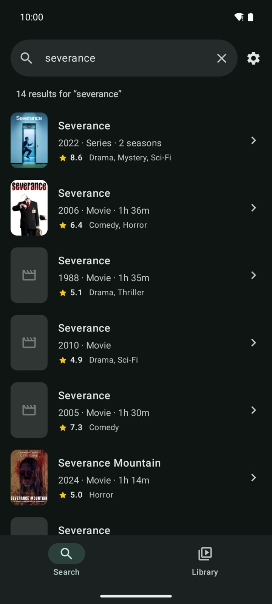
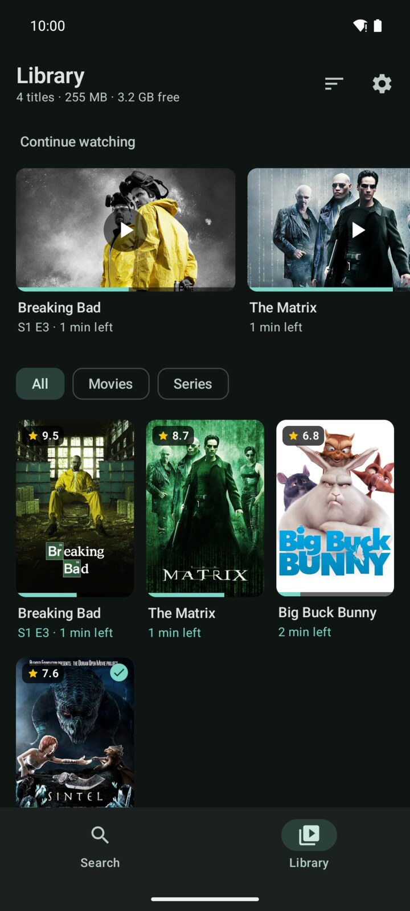
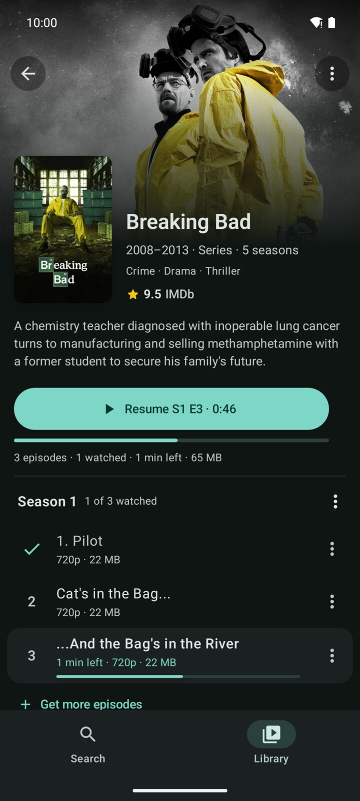

# Comet Download

Search for a movie or series, pick a cached result, and download it through Real-Debrid or TorBox for offline viewing. Available as an Android app and a terminal CLI. Built from a fork of [Comet](https://github.com/g0ldyy/comet).

You need your own Real-Debrid or TorBox API token. Subtitles are downloaded automatically and need no account.

## Android app

<p>
  
  
  
</p>

Download the APK from the [latest release](https://github.com/JohanWes/CometDownloadCLI/releases/latest) (Android 8+, arm64) and enter your debrid token under Settings.

- **Search**: movies, single episodes or full seasons, in 4K or 1080p. Files go to the phone's `Download` folder and keep downloading in the background.
- **Library**: poster grid of what you have downloaded, with progress, next episode and watched marks. Works offline.
- **Player**: built in (Media3 with FFmpeg decoders, so DTS and TrueHD play). Subtitle and audio track choice, more subtitles from OpenSubtitles while watching, chapters, speed, and gestures for seek, brightness and volume.

Build it yourself with `./gradlew :app:installDebug` (Android SDK with platform 36).

## CLI

Needs Linux or macOS, Python 3.13+ and `git`.

```bash
./cometCLI
```

The first run creates `.venv`, installs dependencies and asks for your debrid provider and token. Search for a title, pick a movie, episode or full season, then pick a result. Downloads are queued and run in the background, and land in `~/Downloads`.

```bash
./cometCLI --query "Example Title"
./cometCLI --provider torbox        # when both tokens are set
./cometCLI --output-dir ~/Videos
./cometCLI --parallel-downloads 3
./cometCLI --restart-comet
```

Inside the CLI: `/jobs` (select a job with the arrows, `Enter` to cancel it), `/clear-finished`, `/help`, `/quit`. `Esc` backs out of a search.

### Configuration

Settings live in `.env` (see [`.env-sample`](.env-sample)):

```dotenv
REALDEBRID_API_TOKEN=
TORBOX_API_TOKEN=

# Optional: subtitles
OPENSUBTITLES_LANGUAGES=en, sv   # first language found wins
OPENSUBTITLES_ENABLED=false      # only to turn subtitles off
```

Each video gets a `.<lang>.srt` file next to it, with no account or API key. Subtitles come from the OpenSubtitles catalogue through the public opensubtitles.org search and Stremio's OpenSubtitles addon.

### Troubleshooting

- `Comet did not become healthy`: check `data/comet_search_download.log`.
- `No streams matched`: no suitable cached result for that title right now.
- `The selected torrent is not cached yet`: pick a result marked `cached`.

## Where your tokens go

- The debrid token is sent to your debrid service through a [StremThru](https://github.com/MunifTanjim/stremthru) server. The default is the public instance `https://stremthru.13377001.xyz`, and whoever runs it can see the token. With the CLI you can run your own and set `STREMTHRU_URL` in `.env`; the Android app always uses the public instance.
- Subtitle lookups send no token or login. They send the title's IMDb id, or the video's file name when there is none, plus a hash and size of the video file to `rest.opensubtitles.org`, and the IMDb id to `opensubtitles-v3.strem.io` as a fallback.
- The CLI keeps tokens in `.env` (mode 600). The app keeps them in encrypted preferences, excluded from backups. Tokens are kept out of logs and error messages.

## Releasing

Set `versionName` and `versionCode` in `app/build.gradle`, then push a matching tag:

```bash
git tag v1.0.0 && git push origin v1.0.0
```

GitHub Actions builds the signed APK and attaches it to a new release.
